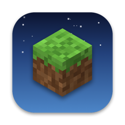
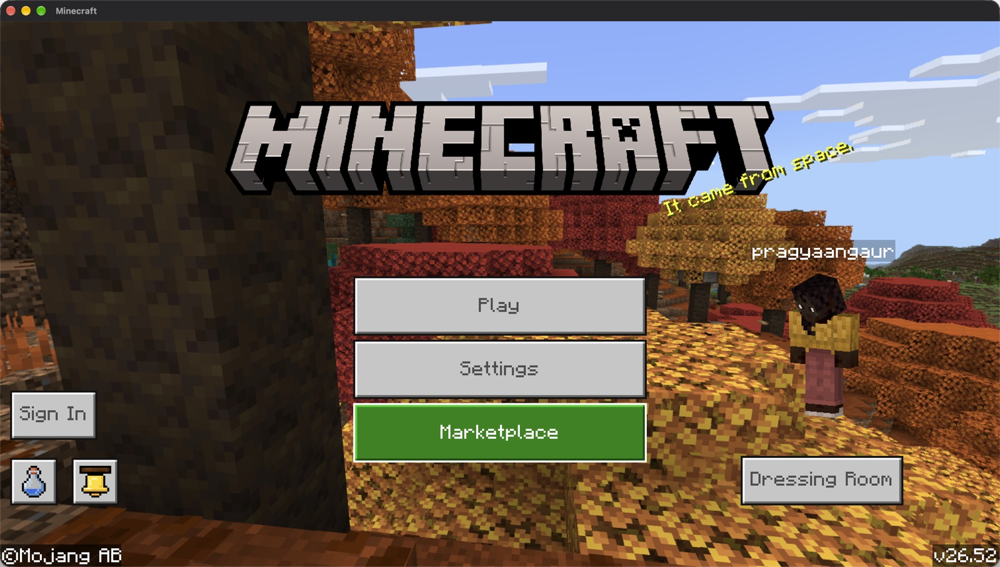
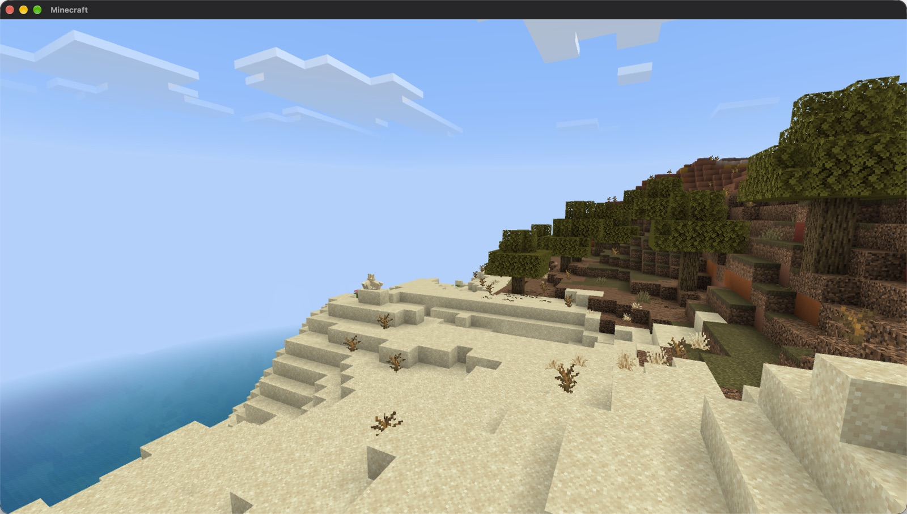
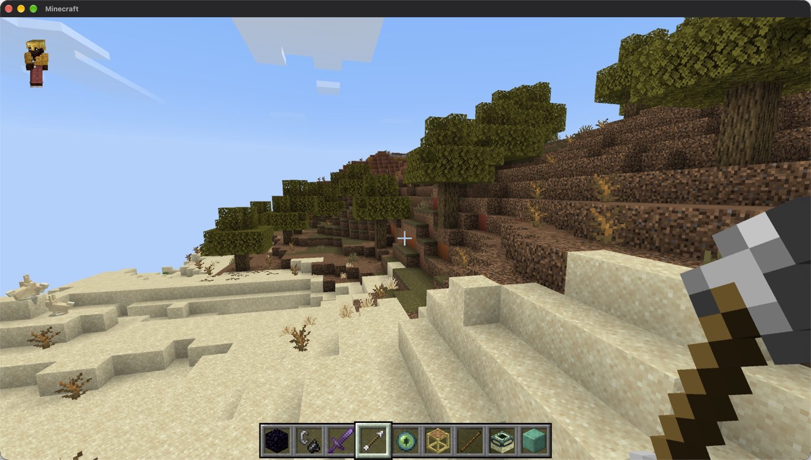
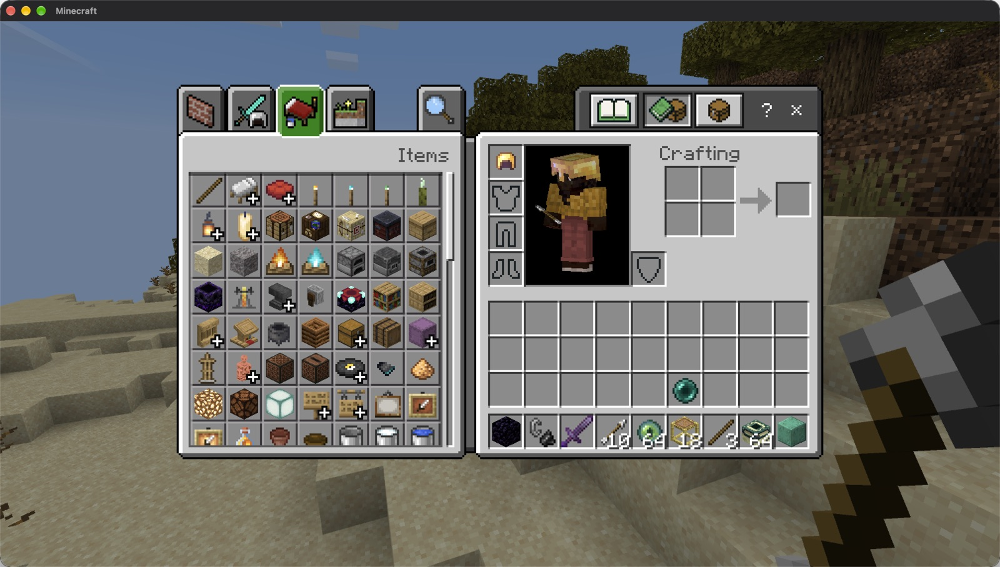
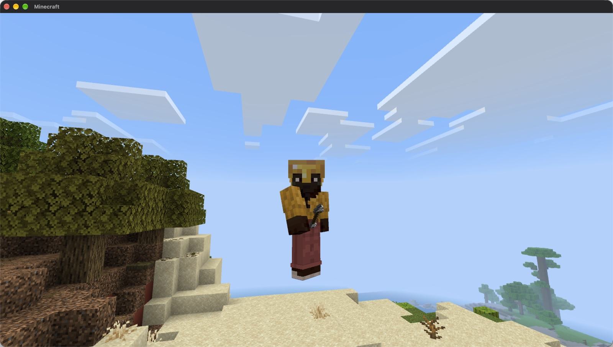

<p align="center">
  
</p>

<h1 align="center">Minecraft Bedrock on macOS</h1>

<p align="center">Play your own copy of Minecraft Bedrock Edition for Windows on a Mac with Apple silicon, fully offline.</p>

<p align="center">
  <a href="https://github.com/pragyaangaur/Minecraft-Bedrock-macOS/releases/latest/download/Bedrock-Launcher.dmg"></a>
  <a href="https://pragyaangaur.github.io/Minecraft-Bedrock-macOS/"></a>
</p>

<p align="center">
  
</p>

## What is this?

Mojang makes Minecraft Bedrock Edition for Windows, phones and consoles, but not for the Mac. This project takes the Windows version of the game that you already own and runs it on a Mac with an M1 chip or newer. It is the real game and not a remake. Survival and creative worlds work, and so do the Nether, the End and the Ender Dragon. A Mac with an M4 chip runs it at about 100 frames per second.

The download contains no game files. You copy the game from a Windows PC on which you own it, and Bedrock Launcher prepares it for the Mac the first time you open it.

<table>
  <tr>
    <td></td>
    <td></td>
  </tr>
  <tr>
    <td></td>
    <td></td>
  </tr>
</table>

## Download and play

1. **Download** [Bedrock-Launcher.dmg](https://github.com/pragyaangaur/Minecraft-Bedrock-macOS/releases/latest/download/Bedrock-Launcher.dmg), open it and drag Bedrock Launcher into your Applications folder.
2. **Allow it to open.** The app is not signed by Apple, so macOS blocks it the first time. Open it once, then go to System Settings, Privacy & Security, scroll down and click Open Anyway.
3. **Bring your game from Windows.** You need the game folder and a memory dump of the running game. [The guide](docs/getting-the-game-files.md) shows how to get both in about 15 minutes.
4. **Open the app.** It asks for the folder, the dump and a player name, prepares the game in about five minutes and starts it. From then on, opening the app starts the game straight away.

You need a Mac with Apple silicon and a copy of Minecraft for Windows version 1.26.52. It was tested on macOS 27. If Rosetta 2 is missing, the app offers to install it.

## What does not work

- Everything online is unavailable, including signing in, Realms, the Marketplace and multiplayer servers.
- The game pauses when its window loses focus, as it does on Windows.
- Only version 1.26.52 of the game has been tested.

## For developers

### Build from source

The disk image is built from this repository, and you can build everything yourself instead of downloading it. You need these.

- Xcode with Apple's Metal toolchain (`xcodebuild -downloadComponent MetalToolchain`).
- [Homebrew](https://brew.sh) with these packages:

  ```bash
  brew install llvm lld mingw-w64 bison flex meson ninja cmake pkgconf python
  ```

- About 30 GB of free disk space and one to two hours for the first build.

Then run the setup with the game folder and the dump:

```bash
./setup.sh --game "/path/to/the/game/folder" --dump "/path/to/Minecraft.Windows.exe_....dmp"
```

It checks the requirements, then downloads and builds GnuTLS, FreeType, WineGDK, LLVM 15 and DXMT into `build/`. It also rebuilds the game's executable from the dump and creates a Wine prefix in `prefix/`. You can run it again at any time, and it skips the steps that are already done. To play, double-click `Play Minecraft.command` or run:

```bash
tools/play_minecraft.sh
```

Add `HUD=1` in front of the command to show Apple's frame rate overlay. The player name comes from your macOS account name, and `PLAYER_NAME=Steve tools/play_minecraft.sh` sets another one. Your worlds are saved in `prefix/drive_c/users/<you>/AppData/Roaming/Minecraft Bedrock/Users/Shared/games/com.mojang/minecraftWorlds`.

To build the app and the disk image from your build, run `scripts/build-app.sh`. It writes `dist/Bedrock-Launcher.dmg`.

### How it works

[docs/how-it-works.md](docs/how-it-works.md) describes every layer and the bugs that had to be fixed. The short version is below.

- The executable is encrypted on disk, so `tools/` rebuilds it from a full memory dump. The tools restore its import table and undo the start-up state the dump captured.
- `patches/wine-gdk` adds the parts of the Xbox GDK runtime this game needs, fixes a heap overrun in WineGDK's async code and fixes Wine's mouse support through GameInput.
- `patches/dxmt` makes DXMT build with current Xcode.
- `stubs/` holds small stand-in DLLs, including an offline replacement for the game's HTTP library.
- `tools/patch_fmod.py` guards FMOD's mixer against a divide by zero at start-up.

### Repository layout

| Path | Contents |
| --- | --- |
| `setup.sh` | Builds everything and prepares your copy of the game |
| `Play Minecraft.command` | Starts the game from Finder |
| `scripts/` | The setup steps, one script per component, and `build-app.sh` |
| `app/` | The launcher inside Bedrock Launcher.app and the code that draws its icon |
| `patches/` | Patches for WineGDK and DXMT, applied to pinned upstream versions |
| `stubs/` | Stand-in Windows DLLs, a seed persona profile and their build script |
| `tools/` | The executable rebuild pipeline, the game runner and the launcher |
| `tools/trace/` | Builds a copy of the executable with logging detours |
| `tools/winput/` | A small Windows program that sends keys and mouse input to the game |
| `tools/dev/` | Helpers for screenshots, input and disassembly while debugging |
| `site/` | The project website, published with GitHub Pages |
| `docs/` | How to get the game files and how the port works |

## Licence

The scripts, tools and stubs in this repository are under the MIT licence in [LICENSE](LICENSE). The patches in `patches/wine-gdk` change WineGDK and fall under its LGPL 2.1 licence. The patches in `patches/dxmt` change DXMT and fall under its MIT licence. The app bundles builds of Wine, GnuTLS, Nettle, GMP, FreeType, DXMT and Python, and their licence texts are in `Contents/Resources/licenses` inside the app. Minecraft is a trademark of Mojang Synergies AB, and this project is not affiliated with Mojang or Microsoft.
